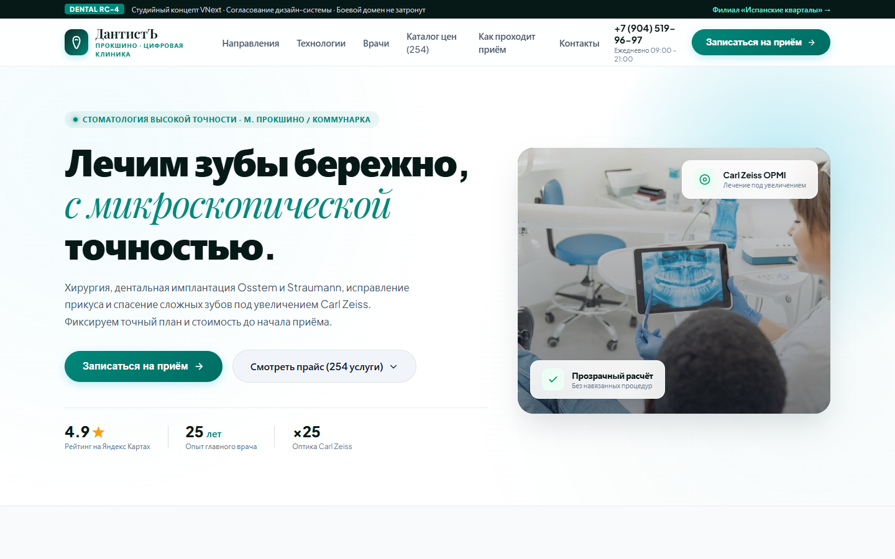
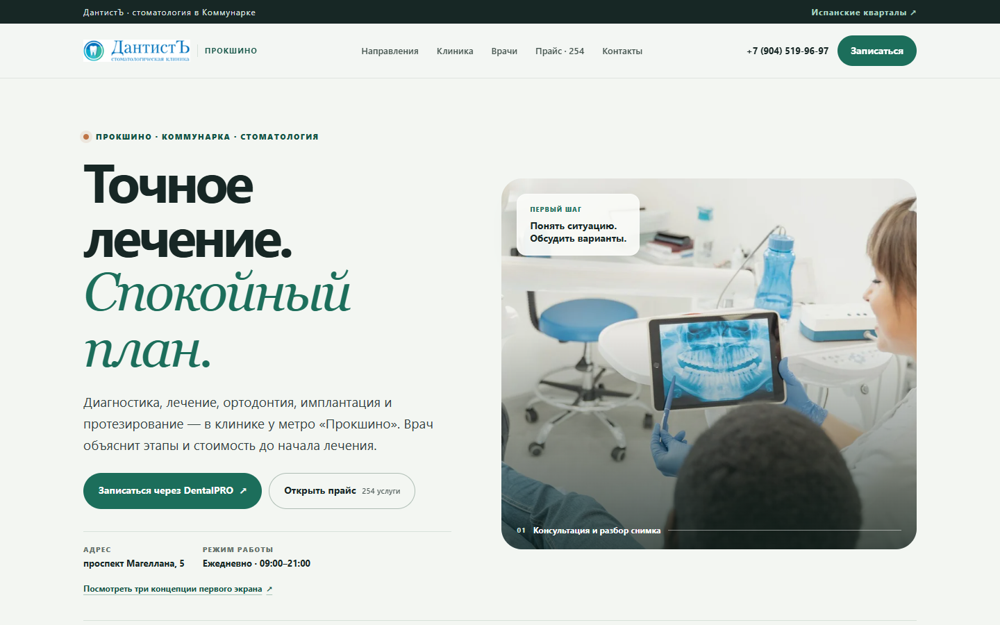
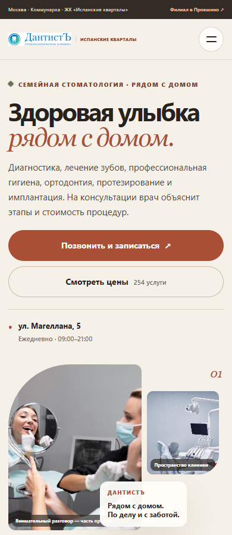
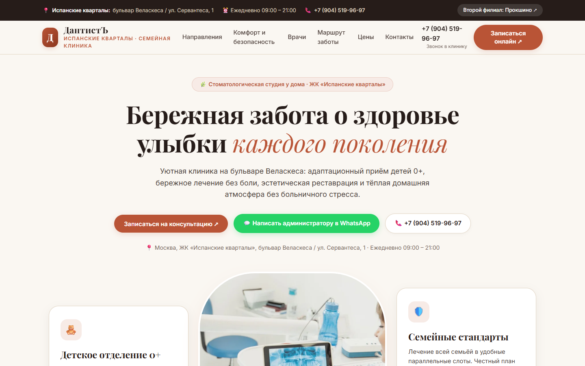
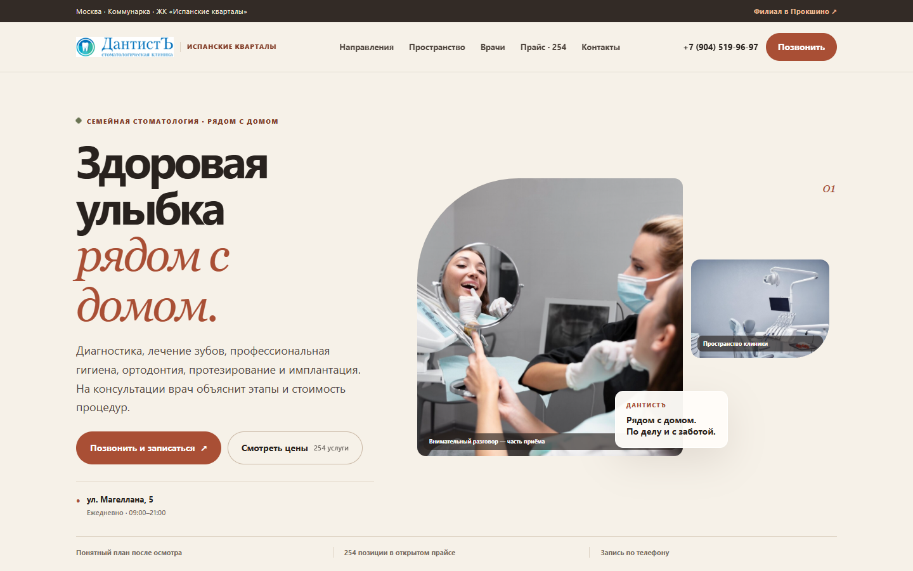

# MANUS — Dental Master Design 2026

## Итог

Подготовлены два самостоятельных адаптивных preview «ДантистЪ» на отдельной ветке `design/manus-dental-master-2026`. Прокшино использует строгую клиническую editorial-систему с крупной реальной фотографией и прямой записью DentalPRO. Испанские кварталы — отдельную тёплую семейную систему с фотоколлажем, иным ритмом секций и телефонной записью. Это не смена палитры: различаются Hero, карточки услуг и врачей, композиция галереи, навигационные акценты и структура страниц.

Основной файл запуска — [`index.html`](../index.html). Из него доступны обе клиники, отдельные каталоги и три варианта Hero Прокшино. Остальные варианты Hero сохранены для сравнения, выбран первый — за ясную иерархию, читаемые CTA и хорошее поведение на мобильном экране.

## Состав результата

- Полностью переработаны главные страницы Прокшино и Испанских кварталов, включая Hero, услуги, врачей, фотографии клиники, запись, цены и контакты.
- Каталоги вынесены на отдельные страницы: [`prices-prokshino.html`](../prices-prokshino.html) и [`prices-ispanskie.html`](../prices-ispanskie.html). В каждом сохранены все 254 позиции, поиск, категории, раскрываемые пояснения и прямые ссылки записи.
- Сохранены три адаптивных направления Hero Прокшино: editorial split, image-first с тёмной фотографией и service-led modular.
- Для preview использованы настоящие логотип, портреты и фотографии клиник с официальных доменов; они перечислены в [заметках по источникам](SOURCE_NOTES.md).
- Общий технический `app.js` не изменялся. Отдельный небольшой `design/price-ui.js` отвечает за дизайн-счётчик и пересечение фильтра и поиска.

## Проверка источников и фактов

Обе production-страницы каталога были сверены с локальными HTML-страницами 9 ноября 2026 года. Для каждой клиники сравнивались названия и цены всех строк: **254 из 254 совпали точно, расхождений не найдено**. Сумма проверенных категорий — 254 (6 консультаций, 2 диагностики, 3 позиции анестезии, 11 гигиены, 25 лечения, 19 эндодонтии, 24 хирургии, 18 имплантации, 66 протезирования, 80 ортодонтии).

Использованы опубликованные телефоны, адрес ул./проспект Магеллана, 5 и часы работы 09:00–21:00 ежедневно. Запись Прокшино ведёт на официальную страницу DentalPRO. На странице Испанских кварталов оставлен прямой звонок, поскольку опубликованная онлайн-ссылка этого филиала направляет в Прокшино. Фиктивных форм и имитации успешной заявки нет.

В новом preview не перенесены неподтверждённые заявления старых черновиков об оборудовании, гарантиях, рейтингах и характеристиках лечения. Исправлены адрес Испанских кварталов, написания и роли врачей, а также промо-цены; подробности и источники приведены в [SOURCE_NOTES.md](SOURCE_NOTES.md).

## До и после

Снимки «до» сделаны с ранее опубликованных GitHub Pages страниц; снимки «после» — из текущей локальной сборки в тех же размерах. Полный указатель всех экранов и секций: [SCREENSHOT_INDEX.md](SCREENSHOT_INDEX.md).

### Прокшино — 390 px

| Ранее опубликованный черновик | Новый preview |
|---|---|
|  |  |

### Прокшино — 1440 px

| Ранее опубликованный черновик | Новый preview |
|---|---|
|  |  |

### Испанские кварталы — 390 px

| Ранее опубликованный черновик | Новый preview |
|---|---|
|  |  |

### Испанские кварталы — 1440 px

| Ранее опубликованный черновик | Новый preview |
|---|---|
|  |  |

## Результаты визуального и функционального QA

Проверены ширины **320, 360, 375, 390, 430, 768, 1024, 1440 и 1920 px**. У двух главных страниц — 18 из 18 проверок без горизонтального переполнения, видимых элементов за границами или отсутствующих изображений. Для двух самостоятельных каталогов также проверены все девять ширин; переполнений не найдено.

В браузере проверены открытие и закрытие мобильной навигации, сочетание поиска и категорий, пустой результат, восстановление полного списка, раскрытие/закрытие пояснения цены и прямые ссылки записи. Mobile-меню проверено на 320, 360, 375, 390 и 430 px. Реальные bounding boxes анализировались в Chromium/Edge, а не только по `scrollWidth`.

Сохранено 28 скриншотов основных секций: семь секций каждой клиники на 390 и 1440 px; отдельно сохранены шесть экранов трёх концепций, полные страницы, верхние экраны с шапкой, каталоги и четыре снимка прежних страниц. Численные измерения находятся в [`design/qa/layout-metrics.json`](../design/qa/layout-metrics.json), все файлы перечислены в [указателе скриншотов](SCREENSHOT_INDEX.md).

### Исправленные визуальные дефекты

1. На ширине 768 px изображение Hero Прокшино принудительно расширяло двухколоночную сетку. Hero теперь аккуратно складывается в колонку на планшетной точке перелома.
2. В мобильном заголовке Испанских кварталов тире оставалось отдельной строкой. Заголовок сокращён до двух намеренных строк.
3. Шапки отдельных прайс-каталогов выходили за край на узких телефонах и при 430 px. Исправлены гибкая ширина и перенос вторичной подписи филиала.
4. Убраны неподтверждённые утверждения, ложные обещания форм и неверное направление записи между филиалами.

## Ограничения и безопасность изменений

Preview остаётся локальной статической сборкой плюс код отдельной ветки. Существующий GitHub Pages и production не заменялись и не перенастраивались; WordPress, DNS и реальные записи не затрагивались. Отдельная временная Pages-публикация не создавалась, чтобы не менять настройки текущего сайта до принятия дизайна. Для просмотра используйте локальный [`index.html`](../index.html); ссылка на ветку ведёт к исходникам, а не к работающему Pages URL.
