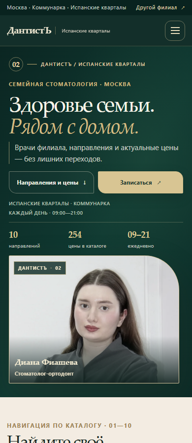

# Dental Master V2 — итоговый дизайн и контроль качества

**Статус:** текущая редакция **V4 — черновик дизайна на согласование**, а не исходный опубликованный сайт. Это локально обслуживаемый preview на отдельной ветке `design/manus-dental-master-2026`; Draft PR #2 открыт для проверки в `main`, не объединён и не развёрнут.

**Локальная точка входа:** [`index.html`](../index.html) → V2 chooser (`v2/index.html`) → сайты двух филиалов. Страница V1 и концепты сохранены в архиве на локальном hub.

**Ветка проекта:** [GitHub · design/manus-dental-master-2026](https://github.com/Valodi-3/dental-master-preview-2026/tree/design/manus-dental-master-2026). Это ссылка на исходники ветки, не на запущенный публичный сайт.

**Draft PR:** [#2 — Dental Master V2 preview and regression fixes](https://github.com/Valodi-3/dental-master-preview-2026/pull/2), base `main`, head `design/manus-dental-master-2026`; состояние `OPEN · Draft`, не объединён.

## Результат

Вместо ещё одного длинного лендинга созданы два связанных мини-сайта: chooser, главные страницы, самостоятельный интерактивный выбор направлений, 20 страниц категорий/услуг, справочник врачей с индивидуальными профилями, каталоги цен и отдельные страницы контактов. Всего генератор воспроизводит **41 статический маршрут**. Навигация, хлебные крошки, ссылки на карточки врача и услуги связывают страницы между собой.

**Текущий V4 арт-дирекшн** — глубокий изумруд с champagne-деталями, редакционная антиква, крупные настоящие портреты врачей и чистая асимметричная сетка. Прокшино показывает Арама Даниеляна справа от текста; Испанские кварталы разворачивают композицию зеркально и используют портрет Дианы Фиашевой в отдельной арочной рамке. Инвазивные/перекрывающие друг друга hero-инсеты убраны. Нижние секции чередуют тёмный блок команды со спокойной светлой поверхностью каталога и галереи. Использованы локальные портреты с проверенных официальных страниц. Референс служит настроением, а не копируемым портфолио-шаблоном.

## Выбор услуги и данные

Интерактивный компонент использует исходный проверенный каталог: **254 услуги, 10 категорий**. Выбор категории и конкретной позиции меняет карточку и цену без перезагрузки; есть собственная ссылка на страницу категории и переход к модальному выбору способа записи. На телефоне компонент становится компактным, управляемым касанием селектором и карточкой, а не уменьшенной настольной сеткой. Выбор является навигацией по услугам, не диагностикой или рекомендацией лечения.

Оба независимых прайса сохраняют 254 строк, поиск, категории, понятный счётчик, пустое состояние и раскрытие деталей. Проверка сопоставила все названия и суммы с локальными сверенными прайсами; расхождений нет. В записи выбранная услуга остаётся заметной в окне, но интерфейс честно говорит, что её данные **не передаются в DentalPRO**.

## Запись и важное различие между филиалами

Модальное окно предлагает телефон, онлайн-маршрут и два явных мессенджера (WhatsApp и Telegram), показывает часы работы и позволяет скопировать номер; звонок использует `tel:+79045199697`. Новая нижняя панель на телефоне сначала показывает все способы и не запускает внешний переход, пока пользователь не нажмёт выбранное действие. Для звонка есть предварительный шаг; проверены Escape, закрытие кликом по фону, восстановление фокуса, подпись диалога и открытие внешней ссылки в новой вкладке. Фиктивных форм и сообщений «заявка принята» нет.

По аудиту и действующему сайту онлайн-переход, используемый Испанскими кварталами, открывает DentalPRO **филиала Прокшино**; отдельная рабочая ссылка филиала Испанские кварталы не подтверждена. Поэтому их сайт явно маркирует «DentalPRO · Прокшино» и советует позвонить, если нужна запись именно в Испанские кварталы. Это уточнение видно в карточке записи и на странице контактов — пользователь не должен принять расписание Прокшино за запись в другой филиал. Проверенные первоисточники и ограничения зафиксированы в [`V2_SOURCES.md`](V2_SOURCES.md).

## Проверки и артефакты

Последний полный запуск Chromium/Playwright дал:

- **41 маршрут × 9 ширин** (320, 360, 375, 390, 430, 768, 1024, 1440, 1920 px): 369 проверок.
- Ещё **123 проверки** при увеличении текста до 200% (320, 390 и 1440 px); суммарно 492 проверки габаритов DOM.
- **0** горизонтальных переполнений, изображений с ошибкой загрузки и ошибок взаимодействий.
- Проверены переключение категорий в обеих клиниках, варианты услуг, точные ценовые фильтры/поиск/пустой результат/детали, мобильное меню с Escape и оба сценария записи.
- Создан **41 снимок Chromium**: chooser, страницы и крупные секции, телефонный шаг, оба booking-модала и сравнение старого/new дизайна на мобильном и desktop.

Результаты сохранены в [`layout-metrics.json`](../design/v2qa/layout-metrics.json); все изображения сгруппированы в [индексе скриншотов V2](V2_SCREENSHOT_INDEX.md). Ниже показаны две мобильные пары до/после.

### Прокшино — до / после, мобильный экран


### Испанские кварталы — до / после, мобильный экран


## Исправления root-страниц и результат 30/30

На дизайн-ветке проверен **неизменённый** набор из tech-коммита `72ad9a3` — 30 проверок, включая 9 ширин на каждой из двух главных страниц. Финальный результат: **30/30 PASS**. Дополнительный прогон: **10/10** сочетаний «филиал × ширина» (390, 768, 1024, 1440, 1920 px, 0 px overflow), оба диалога записи ведут на точный URL DentalPRO, шесть состояний поиска работают, все **5/5** локальных официальных портретов успешно загружаются. Подробные JSON: [полный 30/30 отчёт](../design/v2qa/tech-root-qa-30-30.json), [responsive и browser smoke](../design/v2qa/regression-validation.json), [сравнение исходной tech-основы и дизайн-ветки](../design/v2qa/regression-comparison.json).

### Прокшино — 1024 px: исходная tech-основа / результат дизайн-ветки

В нетронутом tech-коммите тест обнаружил на ширине 1024 px прокрутку 36 px (ширина документа 1060 px). Этот дефект уже был исправлен в существующей дизайн-ветке до нынешней небольшой правки: как «до», так и «после» текущего патча фактический scroll width равен viewport. CSS существующей responsive-композиции сохранён; для ясности нижняя пара сравнивает tech-baseline с итоговой дизайн-веткой, а не приписывает этот CSS-фикс текущему коммиту.

| Tech-baseline, 1024 px | Итоговая дизайн-ветка, 1024 px |
|---|---|
|  |  |

### Испанские кварталы — портреты врачей

Три удалённых портрета из tech-снимка тест-отчёт пометил как «broken», но прямой повтор проверки показал HTTP 200 и корректные image MIME-типы; при принудительной загрузке все три имеют ненулевой `naturalWidth`. Это была гонка с `loading="lazy"`, а не воспроизведённый 404. Дизайн-ветка использует проверенные локальные копии официальных фото и загружает их с низким приоритетом заранее, без внешней зависимости.

| Исходный tech-снимок | Итоговая локальная галерея, 390 px |
|---|---|
|  |  |

### Новые root-взаимодействия

Кнопка в шапке теперь открывает реальный accessible booking dialog, а меню обеих страниц показывает настоящий онлайн-переход; для Испанских кварталов пункт прямо обозначен как запись в Прокшино, а свой филиал можно выбрать по телефону. Фиктивной формы нет. Быстрый поиск фильтрует точные примеры из прежнего полного каталога на 254 позиции; результат кликабельный и ведёт в соответствующую категорию, а запрос без совпадений показывает переход в полный прайс.

| Запись: Прокшино | Запись: Испанские кварталы | Быстрый поиск: Прокшино |
|---|---|---|
|  |  |  |

## Как пересобрать и посмотреть локально

Из корня клона запустите генератор и статические gates:

```powershell
python design/build_v2.py
python design/v2_verify.py --architecture --selector-data --booking --doctors --catalogues --preview --evidence
python design/v2_visual_qa.py
```

Чтобы открыть сайт по локальному HTTP (PowerShell из корня репозитория):

```powershell
python -m http.server 4173 --bind 127.0.0.1
```

Затем откройте `http://127.0.0.1:4173/` для chooser проекта либо сразу `http://127.0.0.1:4173/v2/` для селектора филиала. Завершите сервер `Ctrl+C`.

## Безопасность и предел preview

Существующая GitHub Pages-сборка не имеет обнаруженного изолированного preview-пути: изменение её source могло бы заменить текущую публикацию. Поэтому GitHub Pages-настройки и публичный `main` не переключались; production WordPress не менялся, и PR Antigravity не объединялся. Публичная ветка содержит код и артефакты, но её URL **не является** живым preview. Для согласования сейчас предоставлена полностью самодостаточная локально обслуживаемая сборка. Для фактического публичного показа понадобится отдельное preview-окружение или отдельный Pages target.

Техническая зона Antigravity сохранена отдельно; общий `app.js` не редактировался. Точный список исследованных источников, каталогов, записи и референса — в [`V2_SOURCES.md`](V2_SOURCES.md); acceptance ledger — в [`GATES.md`](../GATES.md).


## Визуальная отделка после замечания «всё ещё сыро»

Сделал отдельную проходку именно по визуальному ощущению, а не только по функциональности. Первый экран Прокшино стал самостоятельным тёмно-зелёным клиническим блоком с крупным реальным фото, ясными действиями и выровненными фактами. Испанские кварталы получили собственный тёплый фон и асимметричную композицию из двух официальных кадров: это больше не та же hero-сетка, перекрашенная в терракотовый цвет.

Убрал повтор одного и того же фото в нескольких блоках: на Прокшино селектор использует отдельный кадр, а галерея — снимки гигиены, микроскопа и приёма; галерея Испанских кварталов тоже не дублирует оба кадра hero. Поднял кегль поясняющего текста и контролов селектора на мобильном. Отдельно исправил перенос суммы/₽ в чипах процедур — стоимость теперь остаётся цельной строкой, а название услуги переносится независимо.

**Контроль после изменений:** полный Chromium-прогон: `routes=41`, `routeChecks=369`, `zoomChecks=123`, `totalLayoutChecks=492`, `overflow=0`, `brokenImages=0`, `interactionErrors=0`; переходы селектора, прайсов и записи проверены. Новый отдельный тест ценовых чипов: **6 сочетаний** (2 филиала × 3 ширины 320/360/390 px), **168 меток цены**, переносов суммы и ₽ — **0**. JSON теста — [`polish-currency-results.json`](../design/v2qa/polish-currency-results.json); общий результат — [`layout-metrics.json`](../design/v2qa/layout-metrics.json).

### Мобильные первые экраны — до / после этой итерации

| Филиал | До | После |
|---|---|---|
| Прокшино, 390 px |  |  |
| Испанские кварталы, 390 px |  |  |

Desktop-кадры и обе полные мобильные страницы сохранены в [индексе скриншотов](V2_SCREENSHOT_INDEX.md#визуальная-отделка-после-обратной-связи). Ветка и PR остаются Draft для проверки: это обновление локального preview и отдельной дизайн-ветки, **не merge, не production-релиз и не включение GitHub Pages**.


## Итерация 3 — предыдущая визуальная версия и выбор способа записи

Этот раздел описывает предыдущий проход, на который пользователь дал оценку 3/10; он **заменён V4 выше**. Тогда Испанские кварталы ещё имели тёплую семейную композицию. Визуальный референс по-прежнему используется как настроение — глубокий изумруд, спокойные золотистые акценты, крупная редакционная типографика и ощущение глубины, — но его портфолио-сетка и модельные изображения не копировались. «Объём» сделан только CSS `perspective`/`rotateY` для фотографий при наведении; 3D-фреймворки, сгенерированные изображения и сторонние анимационные библиотеки не использованы. `prefers-reduced-motion` отключает движение.

Кнопка теперь говорит «Записаться» и только открывает панель выбора: **DentalPRO**, **Позвонить** или **Написать в WhatsApp/Telegram**. Звонок сначала показывает подтверждающий шаг с настоящим `tel:` и копированием номера; внешние онлайн- и мессенджер-ссылки не запускаются до отдельного нажатия. На Испанских кварталах в панели явно сказано, что официальная ссылка DentalPRO открывает филиал Прокшино. На телефоне это компактная нижняя панель; оба мессенджера видны без прокрутки в проверенных снимках [Прокшино 390×844](../design/v2qa/screenshots/premium-booking-choice-prokshino-390.png) и [Испанские кварталы 390×844](../design/v2qa/screenshots/premium-booking-choice-ispanskie-390.png).

Отдельный Chromium UX-тест прошёл для обеих клиник: эффект CSS-depth присутствует без тяжёлых/удалённых зависимостей, настройка уменьшения движения соблюдается, а выбор записи проверен на 320, 390 и 1440 px без раннего перехода. Общий responsive-прогон по всем 41 маршруту завершён: **492 измерения, 0 переполнений, 0 проблем с картинками, 0 ошибок взаимодействий**; неизменённый тест root-страниц с tech-основы повторно прошёл **30/30**. Gate проверил **62 PNG-свидетельства**, включая четыре отдельные фотографии предыдущего V4 feedback-состояния. Метрики записаны в [`layout-metrics.json`](../design/v2qa/layout-metrics.json); результаты и защита ветки отражены в [`GATES.md`](../GATES.md), а изображения собраны в [индексе V2](V2_SCREENSHOT_INDEX.md).

Остаётся **только Draft PR #2** на отдельной ветке для проверки: никаких merge, переключения GitHub Pages или изменений production в этой итерации не выполнялось. Отдельное финальное safety-подтверждение ветки и PR см. в [`GATES.md`](../GATES.md).


## Итерация 4 — ответ на оценку «3/10»

Предыдущая версия была слишком похожа на набор универсальных блоков: на первом экране спорили наложенные фото, белый прямоугольник логотипа, декоративные элементы и длинные подписи. Я не стал просто затемнять фон или добавлять больше эффектов. В текущем V4 композиция пересобрана: крупная редакционная типографика, один заметный официальный портрет вместо двух-трёх перекрывающихся изображений, ясная подпись врача и направляющие тонкие champagne-линии. Прокшино строится как широкий текстовый клинический разворот с портретом Арама Даниеляна справа; Испанские кварталы — наоборот, с портретом Дианы Фиашевой слева в спокойной арочной рамке. Оба филиала связаны изумрудной палитрой, но композиционно не копируют друг друга. После hero идут осмысленные разделы услуг, врачей, официальной галереи и контактов.

Использованы уже имеющиеся подлинные фото и проверенные портреты врачей; фотографии заново не генерировались. Плавность и глубина — локальный CSS `perspective`/`rotateY`, без Three.js, GSAP и платных генераций; `prefers-reduced-motion` отключает движение. Из кнопки «Записаться» сначала открывается выбор: онлайн DentalPRO, телефонный шаг или WhatsApp/Telegram. Для Испанских кварталов назначение ссылки на филиал Прокшино явно подписано.

**Результаты текущей сборки:** 41 маршрут × 9 ширин и три 200%-масштабных режима — **492/492** layout-проверки без переполнения, сломанных изображений или ошибок взаимодействия; отдельная интеракция записи и CSS-depth — PASS на обеих ветках, в том числе ширины 320/390/1440; неизменённый regression-набор корневых сайтов — **30/30**; селектор цен — **168/168** меток без переносов рубля; собранная документация содержит **62 PNG-свидетельства**. Подтверждены все 254 строки прайса на филиал. Свежие кадры и полный mobile-page — в [индексе скриншотов](V2_SCREENSHOT_INDEX.md#итерация-4--переосмысление-после-оценки-310).

| Филиал | До · mobile 390 px | После · mobile 390 px |
|---|---|---|
| Прокшино |  |  |
| Испанские кварталы |  |  |

Desktop 1440 px: [Прокшино — до](../design/v2qa/screenshots/v4-before-prokshino-desktop-1440.png) · [после](../design/v2qa/screenshots/v2-desktop-home-prokshino-1440.png); [Испанские кварталы — до](../design/v2qa/screenshots/v4-before-ispanskie-desktop-1440.png) · [после](../design/v2qa/screenshots/v2-desktop-home-ispanskie-1440.png). Полные страницы на 390 px: [Прокшино](../design/v2qa/screenshots/v2-full-home-prokshino-390.png) · [Испанские кварталы](../design/v2qa/screenshots/v2-full-home-ispanskie-390.png). Модальные варианты записи: [Прокшино](../design/v2qa/screenshots/premium-booking-choice-prokshino-390.png) · [Испанские кварталы](../design/v2qa/screenshots/premium-booking-choice-ispanskie-390.png).

Это по-прежнему **дизайн-черновик, не замена оригиналу**: изменения публикуются только в отдельной `design/manus-dental-master-2026` и уже открытом Draft PR #2 для просмотра. Я не объединял PR, не переключал Pages и не менял `main`, Antigravity-tech, исходный `app.js` или production. Публичная ссылка на ветку — это ссылка на код, а не опубликованный preview; работающий preview остаётся локальным. Подробная проверка границ публикации — в [G20](../GATES.md).
